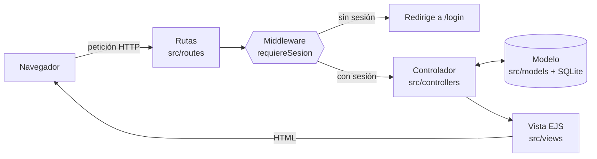

# AdminPro · Sistema de gestión de personal


Aplicación web para una **empresa de administración** que gestiona a su personal: registrar, consultar, editar y dar de baja empleados. Está construida con el **patrón MVC** y tiene un **sistema de login**: solo el personal autenticado puede entrar al módulo de empleados.

> Tarea 3 · Ingeniería Web (UDLA): *Desarrollo de la aplicación (CRUD y Login con MVC)*.

---

## Índice

- [Funcionalidades](#funcionalidades)
- [Tecnologías](#tecnologías)
- [Arquitectura MVC](#arquitectura-mvc)
- [Estructura del proyecto](#estructura-del-proyecto)
- [Instalación y uso](#instalación-y-uso)
- [Rutas](#rutas)
- [Seguridad y autenticación](#seguridad-y-autenticación)
- [Cómo comprobar que la contraseña está cifrada](#cómo-comprobar-que-la-contraseña-está-cifrada)
- [Autor](#autor)

---

## Funcionalidades

**Login**
- Inicio de sesión con usuario y contraseña.
- Registro de nuevas cuentas (la contraseña se guarda cifrada con **bcrypt**).
- Cierre de sesión que destruye la sesión en el servidor.
- Si intentas abrir una página protegida sin sesión, te lleva al login y, al ingresar, te devuelve a la página que pediste.

**CRUD de empleados** (sección protegida)
- **Crear**: registrar un empleado (nombre, correo corporativo, cargo, departamento, salario y fecha de ingreso).
- **Leer**: listado con buscador por nombre, cargo o departamento, y un resumen con el total de empleados y la nómina mensual.
- **Actualizar**: editar los datos de un empleado.
- **Eliminar**: dar de baja a un empleado (con confirmación).
- Validación en el servidor: campos obligatorios, correo válido y sin repetir, departamento de la lista, salario ≥ 0 y fecha válida.

## Tecnologías

| Herramienta | Uso |
|---|---|
| [Node.js](https://nodejs.org/) 20+ | Entorno de ejecución |
| [Express 4](https://expressjs.com/) | Servidor web y enrutamiento |
| [EJS](https://ejs.co/) | Motor de plantillas (las **Vistas**) |
| [better-sqlite3](https://github.com/WiseLibs/better-sqlite3) | Base de datos SQLite (un solo archivo, sin instalar nada aparte) |
| [express-session](https://github.com/expressjs/session) | Manejo de sesiones con cookie |
| [bcryptjs](https://github.com/dcodeIO/bcrypt.js) | Cifrado (hash) de contraseñas |
| [method-override](https://github.com/expressjs/method-override) | Permite usar `PUT` y `DELETE` desde formularios HTML |
| [dotenv](https://github.com/motdotla/dotenv) | Variables de entorno desde `.env` |

## Arquitectura MVC



| Capa | Carpeta | Responsabilidad |
|---|---|---|
| **Modelo** | `src/models/` | Acceso a la base de datos (consultas SQL) y validación de los datos. `usuario.model.js` además cifra y verifica contraseñas. |
| **Vista** | `src/views/` | Plantillas EJS que generan el HTML: login, registro, listado y formulario de empleados. |
| **Controlador** | `src/controllers/` | Recibe la petición, llama al modelo y decide qué vista mostrar o a dónde redirigir. |

Además:
- **Rutas** (`src/routes/`): asocian cada URL y método HTTP con un método del controlador.
- **Middlewares** (`src/middlewares/`): `requiereSesion` protege las rutas privadas.

## Estructura del proyecto

```
tarea3-crud-login/
├── scripts/
│   └── ver-usuarios.js          # Muestra los usuarios y el hash de su contraseña
├── src/
│   ├── app.js                   # Punto de entrada: configura Express y las rutas
│   ├── config/
│   │   └── db.js                # Conexión a SQLite, tablas y datos iniciales
│   ├── models/
│   │   ├── usuario.model.js     # Usuarios + bcrypt
│   │   └── empleado.model.js    # CRUD de empleados + validación
│   ├── controllers/
│   │   ├── auth.controller.js   # Login, registro, logout
│   │   └── empleados.controller.js
│   ├── middlewares/
│   │   └── auth.middleware.js   # requiereSesion, soloInvitados
│   ├── routes/
│   │   ├── auth.routes.js
│   │   └── empleados.routes.js
│   ├── views/
│   │   ├── partials/            # cabecera y pie compartidos
│   │   ├── auth/                # login.ejs, registro.ejs
│   │   ├── empleados/           # index.ejs, form.ejs
│   │   └── 404.ejs
│   └── public/css/estilos.css
├── .env.example
├── package.json
└── README.md
```

## Instalación y uso

**Requisitos:** Node.js 20 o superior y npm.

1. Clona el repositorio e instala las dependencias:

   ```bash
   git clone <url-del-repositorio>
   cd tarea3-crud-login
   npm install
   ```

2. Crea el archivo `.env` a partir del ejemplo:

   ```bash
   cp .env.example .env        # En Windows (cmd): copy .env.example .env
   ```

3. Arranca la aplicación:

   ```bash
   npm start                   # o "npm run dev" para reiniciar solo al guardar cambios
   ```

4. Abre **http://localhost:3000**.

La base de datos `adminpro.db` se crea sola la primera vez, con un usuario administrador y tres empleados de ejemplo.

**Cuenta de prueba**

| Usuario | Contraseña |
|---|---|
| `admin` | `Admin123` |

(Se pueden cambiar en `.env` con `ADMIN_USUARIO` y `ADMIN_PASSWORD` antes del primer arranque.)

## Rutas

| Método | Ruta | Descripción | Protegida |
|---|---|---|:---:|
| GET | `/` | Redirige a `/empleados` o a `/login` | |
| GET | `/login` | Formulario de inicio de sesión | |
| POST | `/login` | Valida credenciales y crea la sesión | |
| GET | `/registro` | Formulario de registro | |
| POST | `/registro` | Crea un usuario con la contraseña cifrada | |
| POST | `/logout` | Cierra la sesión | |
| GET | `/empleados` | **Leer**: listado y búsqueda (`?buscar=`) | 🔒 |
| GET | `/empleados/nuevo` | Formulario de creación | 🔒 |
| POST | `/empleados` | **Crear** | 🔒 |
| GET | `/empleados/:id/editar` | Formulario de edición | 🔒 |
| PUT | `/empleados/:id` | **Actualizar** | 🔒 |
| DELETE | `/empleados/:id` | **Eliminar** | 🔒 |

## Seguridad y autenticación

- **Contraseñas cifradas con bcrypt** (10 rondas, con *salt* aleatorio). En la base nunca se guarda la contraseña en texto plano, solo su hash.
  - La consigna menciona MD5 como ejemplo. Se eligió **bcrypt** porque MD5 ya no se considera seguro para contraseñas: es muy rápido de calcular y existen tablas con millones de hashes MD5 precalculados. bcrypt es lento a propósito y agrega un *salt*, así dos usuarios con la misma contraseña tienen hashes distintos.
- **Rutas protegidas en el servidor**: todas las rutas de `/empleados` pasan por el middleware `requiereSesion`. Sin sesión, cualquier petición (también `PUT` o `DELETE`) se redirige a `/login`. Esconder botones no basta; quien decide es el servidor.
- **Sesión** con cookie `HttpOnly` y `SameSite=Lax`, válida por 1 hora. Al iniciar sesión se regenera el identificador de sesión (evita la fijación de sesión) y al salir se destruye.
- **Sin caché en páginas privadas** (`Cache-Control: no-store`): después de cerrar sesión, el botón "Atrás" del navegador no muestra los datos.
- **Redirección segura**: el parámetro `?volver=` solo acepta rutas internas, nunca otro sitio.
- **Consultas SQL parametrizadas** (`?`) contra inyección SQL, y **escape de HTML** en las vistas (`<%= %>` de EJS) contra XSS.
- El mensaje de error del login es genérico ("Usuario o contraseña incorrectos") para no revelar qué usuarios existen.

## Cómo comprobar que la contraseña está cifrada

Con la app creada al menos una vez, ejecuta:

```bash
npm run usuarios
```

Verás algo así (el hash cambia en cada instalación):

```
┌─────────┬────┬─────────┬────────────────────────────────────────────────────────────────┐
│ (index) │ id │ usuario │ hash_password                                                  │
├─────────┼────┼─────────┼────────────────────────────────────────────────────────────────┤
│ 0       │ 1  │ 'admin' │ '$2b$10$F9xUEIbh6FrQLBeEL.KxGes0YLXXHMCo2kCHeJiu/2yjjlHvax4IC' │
└─────────┴────┴─────────┴────────────────────────────────────────────────────────────────┘
```

`$2b$` indica bcrypt y `10` el número de rondas. También puedes abrir `adminpro.db` con cualquier visor de SQLite (por ejemplo, la extensión *SQLite Viewer* de VS Code) y revisar la tabla `usuarios`.

## Autor

**Andrés Méndez Cazares** · Ingeniería Web · Universidad de Las Américas (UDLA)
